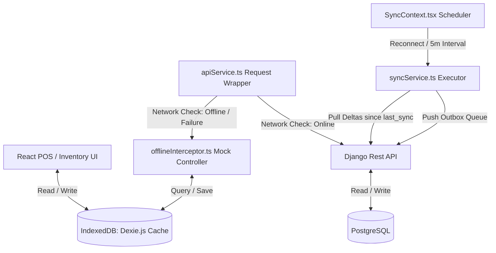

# Quantum Stack: Offline-First & Sync Architecture Guide

This document describes the offline-first capabilities of the **Quantum Stack Inventory & POS** application. It explains how data is cached locally, how requests are intercepted transparently, and how bi-directional synchronization behaves.

---

## 1. High-Level Architecture

The application adopts an **Offline-First** model where the client device acts as the primary data store during POS terminal actions. 

### Architectural Principles:
* **Client-side UUIDs**: All primary keys (`id` fields) are generated as v4 UUIDs on the client device. This guarantees database compatibility and prevents ID collision when pushing new records.
* **Soft Deletes**: Deletion sets a `deleted = True` boolean flag instead of executing a SQL `DELETE` statement. This retains the changelog history needed for pulling client updates.
* **Relational Mocking**: The offline mock layer enriches products with categories, inventories, and active batches locally so that the front-end layout components render seamlessly without connection dependencies.

---

## 2. Client Database Schema (IndexedDB)

Local persistence is powered by **Dexie.js**, providing transaction safety and quick indexes:

* **`categories`**: Local category configurations.
* **`products`**: Product details, stock counts, and prices.
* **`stockBatches`**: FEFO batches (expiry tracking).
* **`productInventories`**: Threshold settings and SKUs.
* **`customers`**: Client directories.
* **`sales`**: Header records of POS transactions.
* **`saleItems`**: Line items linked to sales.
* **`outbox`**: A FIFO queue tracking writes (`create`, `update`, `delete`) performed offline.

---

## 3. Request Interception & Fallback

The interception layer hooks into `apiService.ts` to capture and resolve HTTP methods:

### GET Request Interception:
If the user is offline, `apiService.get` forwards requests to `offlineInterceptor.ts`, which mimics Django REST responses:
* **Search / Pagination**: Replicates Django filter parameters (e.g. searching products by name or SKU, filtering categories).
* **Relational Enrichment**: Queries related IndexedDB tables to embed nested data (such as nesting category detail objects within the product).

### POST / PUT / PATCH / DELETE Interception:
If a write fails due to network dropouts or is blocked offline:
1. The operation is registered immediately in the local IndexedDB table (optimistic UI update).
2. The mutation is saved into the **Outbox Queue** table.
3. Once the connection is recovered, the outbox entries are serialized and pushed to `/api/sync/push/`.

---

## 4. Bi-Directional Synchronization Protocol

Synchronization is handled by `syncService.ts` and managed by the React context `SyncProvider`:

### A. Push (Client to Server)
1. Fetches all records from the `outbox` table ordered by timestamp.
2. Sends a single POST request containing mutations to `/api/sync/push/`.
3. Django processes the list in a transaction.
4. On success, the successfully synced items are deleted from the local IndexedDB outbox.

### B. Pull (Server to Client)
1. Sends the client's `last_pulled_at` timestamp to `/api/sync/pull/`.
2. Django filters all records across all tables updated after that timestamp.
3. Django returns the changes dictionary.
4. The client applies the changes (deleting soft-deleted records and writing new/updated records).
5. The local `last_pulled_at` timestamp is updated to the server's current timestamp.

---

## 5. Conflict Resolution (Last-Write-Wins)

To resolve conflicts when multiple terminals edit the same record offline:
* Every mutation payload includes an `updated_at` timestamp indicating when the user saved the edit.
* In Django, before applying an update, it checks:
  `if client_updated_at <= server_updated_at:`
* If true, it means a newer update was already pushed to the database. The client's stale update is discarded (`conflict_resolved_server_won`).
* If false, the client's change is applied.

---

## 6. How to Test the Offline Setup

1. **Verify Online Connection**: Notice the connection status indicator pill in the navbar says **`Online`** (green dot).
2. **Go Offline**: Open Chrome DevTools (`F12`), go to the **Network** tab, and toggle the throttling dropdown from "No Throttling" to **`Offline`**.
3. **Observe UI**:
   * The navbar indicator changes to **`Offline`** (amber warning).
   * A toast notification alerts you that modifications will save locally.
4. **Log Transactions**: Check out a POS sale or add a product. The UI will process it instantly.
5. **Inspect the Queue**: Go to DevTools -> **Application** -> **IndexedDB** -> `qstack_db_{tenant}`. Inspect the `outbox` table to see the mutation queued up.
6. **Go Back Online**: Set the network throttling back to **`No Throttling`**.
7. **Verify Push**: The navbar indicator will pulse blue (**`Syncing`**) and then return to **`Online`**. The local `outbox` queue will be cleared, and the transaction will be registered in your Django admin panel.
